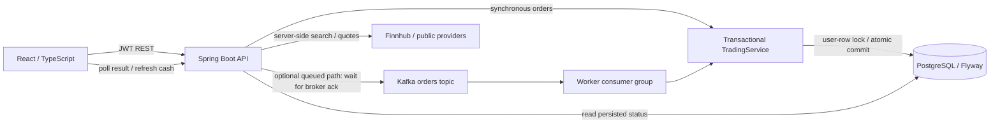
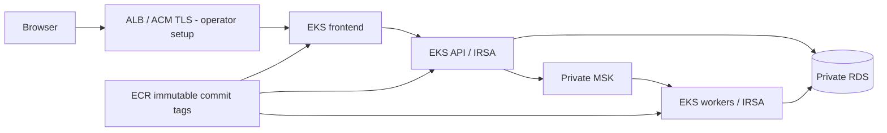
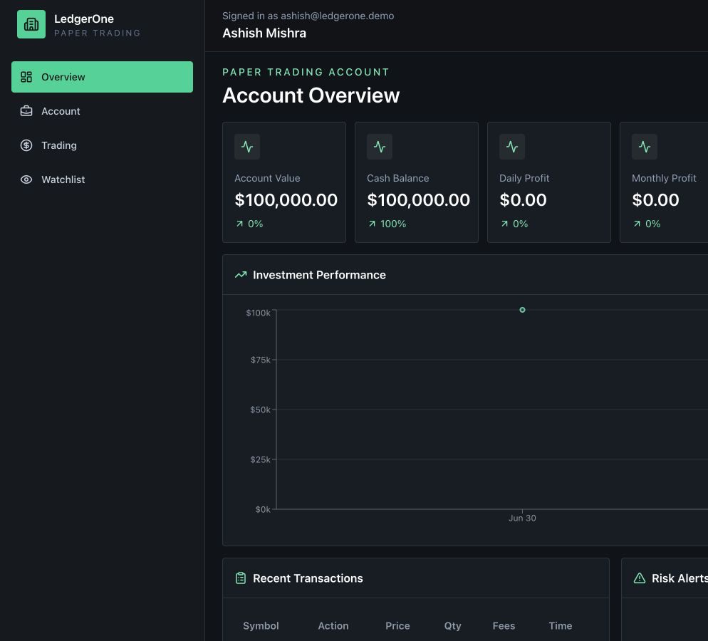
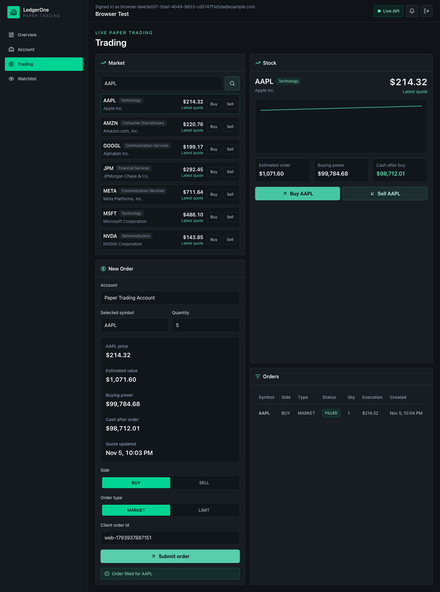

# LedgerOne — Distributed High-Throughput Stock Paper Trading Platform

[Live App](https://ledger-one-mocha.vercel.app) | [GitHub](https://github.com/Aashish-cs/LedgerOne) | [Backend Health](https://ledgerone-api-litx.onrender.com/actuator/health) | [API Status](https://ledgerone-api-litx.onrender.com/api/system/status)

## Overview

Practice stock trading with **simulated money and simulated trades**. Each
registered user receives one paper account funded with **$100,000**. Search stocks,
review quotes, buy/sell, track holdings and inspect trade history. LedgerOne is
not a brokerage and cannot move real money.

The distributed lab adds Kafka-backed order ingestion and separate workers.
"High-throughput" describes the engineering direction, not a verified 12,500
transactions/sec result.

**Deployment distinction:** the hosted demo runs synchronous trading on
Render/Vercel. This `distributed-trading-lab` branch is exercised locally with
PostgreSQL, Kafka and Kind. AWS EKS is a configured deployment target, not a
verified deployment. Review the metric table before quoting resume numbers.

## Features

- Registration, BCrypt passwords, JWT access tokens and rotating hashed refresh tokens.
- User/admin roles and user-scoped account, order and watchlist access.
- One $100K paper account, buying power, holdings, realized/unrealized P/L and ledger.
- Backend stock search/quotes: Finnhub when configured, public fallbacks and cache.
- Market/limit buy/sell orders, fees, cancellation and recorded rejection reasons.
- Cash/share checks repeated at limit execution; pending limits reserve nothing.
- Atomic cash/holding/order/ledger writes under a per-user database row lock.
- Exact client-order replay returns the original; synchronous payload conflicts receive 409.
- Watchlists, notifications, audit history, admin review and rule-based risk.
- Optional Kafka order API, worker group, retries, DLT and recovery checks.
- Account chart uses real session observations, not invented price motion.

## Technology Stack

| Layer | Implemented technologies and purpose |
| --- | --- |
| Frontend | React, TypeScript, Vite, Tailwind; Router, TanStack Query, Axios, React Hook Form, Recharts, Lucide |
| Backend | Java 21, Spring Boot 3.5, Spring Security, Bean Validation, Spring Data JPA |
| Persistence | PostgreSQL 16, Flyway, UUID keys, NUMERIC money and relational constraints |
| Queue lab | Apache Kafka 3.9.1, Spring Kafka, keyed partitions, retries and DLT |
| Runtime | Multi-stage non-root Docker images, Compose, Kind/Kubernetes, metrics-server, CPU HPA |
| Testing | JUnit 5, Mockito, MockMvc, PostgreSQL Testcontainers, Node scenario/load harnesses, Playwright browser checks |
| CI | GitHub Actions build/tests, npm audit, Trivy, Kubernetes and Terraform validation |
| Hosted demo | Vercel frontend; Render API and managed PostgreSQL |
| Future AWS target | Terraform for EKS, VPC, ECR, RDS, MSK, IRSA and control-plane logging; not cloud-validated |

## Architecture



The browser never supplies an authoritative execution price or receives a Finnhub
secret. `frontend/src/App.tsx` owns pages; `api/client.ts` sends REST requests and
polls results; `auth/AuthContext.tsx` manages sessions. Backend packages separate
`controller`, `service`, `repository`, `entity`, `dto`, `security`, `orderqueue`,
`audit`, `notification`, `risk` and `scheduler`.

Future AWS reference architecture, **not current runtime**:



## Trading Workflow

1. Authenticate; validate request shape, ticker, quantity and account ownership.
2. Queue mode publishes with the user ID as key and waits for `acks=all` before 202.
3. Return a stable request UUID, client ID and broker partition/offset. The request
   UUID is **not** a committed database order UUID.
4. Worker validates the event and enters `TradingService.placeOrder`.
5. Lock the user's row; check duplicate ID, cash/shares, fees and limit rules.
6. Market orders fill or reject. Nonmarketable limits stay `PENDING`, then can
   become `FILLED`, `REJECTED` or `CANCELLED`. No fictional persistent PROCESSING state.
7. Cash, holdings, order, ledger, audit, notifications and risk commit together.
   Failure rolls back the transaction. Queue acceptance does not deduct cash.
8. UI polls the client order ID and refreshes orders, accounts and dashboard.

Lookup returns 404 before the DB order exists. Durable public receipt/DLT-failure
status is still missing; a queue timeout does not imply execution succeeded.
Queued payload conflicts are detected by the worker, not returned as HTTP 409 by
the publish step. A lookup can still show the original order for that client ID;
clients must not reuse an ID for a different intent. Durable conflict receipts are
part of the remaining queued-status work.

## Kafka Architecture

Source: `backend/src/main/java/com/ledgerone/orderqueue/` and `application.yml`.

- `ledgerone.orders.v1`: six partitions, user-ID key for per-user partition order.
- `ledgerone-order-workers`: replicas share partitions within one consumer group.
- DB commit precedes successful listener return and record offset commit.
- Crash after DB commit but before offset commit can replay; idempotent DB writes prevent a second trade.
- Retryable failures get two retries, one-second backoff. Invalid/malformed events skip retries.
- `ledgerone.orders.v1-dlt`: failed records; DLT publication must be acknowledged.
- Local replication is one, not broker HA. Future MSK config uses replication three/min ISR two.

No DB write occurs in the HTTP publish step, so no unnecessary DB/Kafka dual-write
outbox was added. The tradeoff is no durable public receipt status yet. Delivery
is **at-least-once with idempotent DB effects**, not global exactly-once.
[Real broker recovery/DLT evidence](docs/TESTING.md).

## Database Architecture

**14 business tables, 13 JPA entities**, plus Flyway's metadata history table:

`users`, `roles`, `user_roles`, `portfolios`, `stocks`, `holdings`, `trade_orders`,
`ledger_transactions`, `price_history`, `watchlist_items`, `audit_logs`,
`risk_alerts`, `notifications`, `refresh_tokens`.

Users own portfolios/orders; holdings link a portfolio and stock; each filled
order has one ledger row. `user_roles` is the many-to-many join table.
Unique identity/idempotency keys and cash/quantity checks protect integrity.
V6 adds one ledger row per order and portfolio-history/pending indexes;
applied V1-V5 migrations were not edited.

`@Transactional` plus a pessimistic **user-row** lock serializes trades for one
user across API/worker replicas. READ COMMITTED alone does not prevent double
spending. Different users may proceed concurrently.
[Schema, index measurements and recovery](docs/DATABASE_OPTIMIZATION.md).

## Performance Metrics & Benchmarks

Original numerical claims remain visible. Targets are not achievements.

| Resume claim | Verified measurement | Evidence | Status |
|---|---|---|---|
| 12,500+ mock transactions/sec | 100/sec target run: 248 fills, 19.66 observed fills/sec including drain; 39.72 broker acks/sec. Not sustained capacity. | [Performance report](docs/PERFORMANCE_REPORT.md) | UNVERIFIED |
| 99.99% uptime | Recovered normal run: 131/131 status reads over 20 s; rollout: 94/97 over 20 s. No long-term uptime proof. | [Availability report](docs/AVAILABILITY_REPORT.md) | UNVERIFIED |
| 14 PostgreSQL tables | 14 application tables plus Flyway metadata; clean V1-V6 integration test. | [Schema](docs/DATABASE_OPTIMIZATION.md), [test](backend/src/test/java/com/ledgerone/TradingPostgresIT.java) | VERIFIED |
| 42% latency reduction | Portfolio-history median 16.284 -> 0.105 ms; insert batch 0.041 -> 0.277 ms. No overall read/write improvement established. | [Database optimization](docs/DATABASE_OPTIMIZATION.md) | UNVERIFIED |
| 18 JUnit 5/Mockito tests | 92 passing unit/web-slice + 14 PostgreSQL/server cases; 106 total including parameterized cases, 0 failed/skipped. Original count is outdated. | [Testing](docs/TESTING.md), [raw log](tests/security/backend-verification.txt) | VERIFIED |

Environment: 8 GiB Mac, Colima 4 CPUs/6 GiB, single-node Kind, one DB/broker and
controlled quotes. Five-second submission windows are laptop experiments, not
production capacity certification. Bounded injection reports missed scheduling
slots. Repeated EXPLAIN ANALYZE tests use temporary tables, not production WAL.
[Scripts/raw results](tests/performance/) retain failures, CPU/memory and lag.
[Full claim traceability](docs/RESUME_CLAIM_VERIFICATION.md).

## Docker and Kubernetes

One non-root Java image runs API, worker or scheduler Spring profiles; these are
independently runnable roles, not unrelated domain microservices. Non-root Nginx
serves the frontend on 8080 and proxies `/api`; Compose exposes localhost:5173.

Manifests define startup/readiness/liveness probes, requests/limits, Services,
ConfigMaps, Secret references, rolling Deployments and CPU HPA. Metrics-server is
explicitly required. CPU target: 65%; local replicas 1-3, base/AWS 2-6. Six
partitions limit useful worker parallelism. Lag-based scaling remains future work.

```bash
bash tests/performance/local-kubernetes.sh up
bash tests/performance/local-kubernetes.sh forward
# http://127.0.0.1:18090
```

[Actual local rescale/restart/rollout observations](docs/LOCAL_KUBERNETES.md),
including failed status probes. Local testing does not prove EKS deployment.

## AWS EKS Deployment Readiness

`infra/aws/` wraps `deploy/aws/`: VPC, EKS nodes, ECR, RDS, MSK, IRSA and EKS
logging. Use one state/entry point, not two independent deployments.
Terraform init/validate passed locally; **no cloud resources were provisioned**.

ALB/ACM requires controller installation, an owned domain and reviewed
`ingress.example.yaml` (excluded by default). App monitoring, secret rotation and
node autoscaling are not installed.
[Costs, prerequisites, future deployment/rollback/cleanup](docs/AWS_EKS_DEPLOYMENT.md).

## Getting Started

Java 21, Node 24+, Docker/Compose. Example credentials are disposable demo defaults.
Never commit real .env files, tokens or API keys.

```bash
# Synchronous app: frontend localhost:5173, API localhost:8080
docker compose up --build
docker compose down
```

```bash
# Isolated Kafka lab: API localhost:18080, two workers
docker compose -p ledgerone-queue -f docker-compose.yml -f docker-compose.queue.yml \
  up -d --build --scale worker=2 backend worker
node benchmarks/queued-orders.mjs
docker compose -p ledgerone-queue -f docker-compose.yml -f docker-compose.queue.yml down
```

For a queued frontend set build arguments `VITE_QUEUED_ORDERS=true` and the queue
API base URL. The Kind helper does this automatically. The public Vercel app uses
synchronous trading unless configured otherwise.

Manual development: start PostgreSQL first, then in separate terminals:

```bash
cd backend
./mvnw spring-boot:run
```

```bash
cd frontend
npm ci
npm run dev
```

Backend shell/IDE variables: `DATABASE_JDBC_URL`, `DATABASE_USERNAME`,
`DATABASE_PASSWORD`, `JWT_SECRET` (32+ random bytes), `ALLOWED_ORIGINS`,
`FINNHUB_API_KEY`, `MARKET_LIVE_PRICES_ENABLED`, `MARKET_SIMULATOR_ENABLED`.
A root .env is **not automatically loaded by Spring**.
Frontend: `VITE_API_BASE_URL=http://localhost:8080/api`.
Queue profiles also need `KAFKA_BOOTSTRAP_SERVERS` and created topics.
See [.env.example](.env.example) and queue Compose.
Flyway applies migrations at startup; Hibernate validates the resulting schema.
[Render/Vercel guide](DEPLOYMENT.md).

## API Documentation

Swagger: `/swagger-ui.html`. Envelope: `{success,message,data,timestamp}`.
Swagger/OpenAPI and `/actuator/**` require ADMIN authentication on this branch.
Minimal GET `/livez` and `/readyz` probes remain public; deployment configuration
was updated with the backend. The hosted demo may still run the earlier policy.

| Method | Endpoint | Purpose |
| --- | --- | --- |
| POST | `/api/auth/register`, `/api/auth/login`, `/api/auth/refresh` | Session lifecycle |
| GET | `/api/account/summary`, `/api/portfolios`, `/api/dashboard` | Cash, equity, holdings and current observation |
| GET | `/api/market/stocks/search?query=AAPL`, `/api/market/stocks/AAPL` | Search/quote |
| GET | `/api/market/stocks/AAPL/history` | Stored quote observations, not exchange tick history |
| POST | `/api/orders` | Synchronous order |
| POST / GET | `/api/orders/queued` | Queue receipt / lookup by clientOrderId; order-api profile only |
| POST | `/api/orders/{id}/cancel` | Cancel pending order |
| GET | `/api/portfolios/{id}/orders`, `/api/portfolios/{id}/transactions` | Paginated owned history |
| GET / POST | `/api/watchlist` | List/add tracked stock |
| DELETE | `/api/watchlist/{id}` | Remove tracked stock |
| GET | `/api/admin/users`, `/api/admin/orders`, `/api/admin/audit-logs` | Admin-only review |

Order request (replace placeholder with actual owned UUID):

```json
{"portfolioId":"YOUR_PORTFOLIO_UUID","symbol":"AAPL","side":"BUY","type":"MARKET","quantity":1,"clientOrderId":"my-order-001"}
```

Queue response `data`: `{clientOrderId,requestId,partition,offset}`.
Poll `GET /api/orders/queued?clientOrderId=my-order-001` using the same bearer JWT.
Reuse the client ID after an ambiguous network failure. 401: unauthenticated;
403: forbidden; 409: ID conflict; 503: queue acknowledgement unavailable.
Business-rejected orders remain visible in history.

## Testing

```bash
cd backend
./mvnw test
./mvnw -Pintegration verify
```

```bash
cd frontend
npm ci
npm run lint
npm run build
npm audit --omit=dev --audit-level=high
```

Real DB cases cover concurrent buys/sells, duplicates, rollback, migrations,
auth/refresh and access rules. Real broker scenario assertions cover worker
recovery, replay and DLT; they are not additional JUnit unit tests.
CI builds/scans images and validates infrastructure but never deploys AWS.
Local Trivy failed during disk exhaustion, not a clean scan result.
[Coverage, commands and gaps](docs/TESTING.md). Check remote CI after push.

## Screenshots and Demo

[Open hosted LedgerOne](https://ledger-one-mocha.vercel.app).
Demo user: `user@ledgerone.com` / `User123!`;
admin: `admin@ledgerone.com` / `Admin123!`.
These are public demo identities, not production credentials.
Offline frontend sample mode is not persisted trading or live-quote evidence.



This retained screenshot predates the audit. The hosted app is separate from lab
changes; product screenshots do not demonstrate benchmarks or AWS deployment.

Current local audit build, using controlled seeded quotes and simulated trades:



[Mobile screenshot](tests/browser/results/trading-mobile.png) and
[browser scenario results](tests/browser/results/) are retained separately.

## Project Status

| Area | Status |
| --- | --- |
| Core accounts/auth/trading | Implemented; unit and PostgreSQL tests pass |
| Kafka lab | Ack API, consumer group, replay safety, DLT and recovery exercised locally |
| Local Kubernetes | HPA/restart/rollout evidence retained, including failures |
| AWS | Configuration/local validation only; IAM/TLS/MSK/RDS/EKS runtime unverified |
| Throughput / uptime / overall latency | Original targets remain unverified |
| Security | Stronger state/refresh/input checks; localStorage tokens, demo accounts and no rate limits remain limitations |
| Analytics | Rule-based risk, not a validated financial model; session equity observations, not historical NAV |
| CI / images | Backend/frontend/Kafka/config jobs and frontend image scan pass. Two Spring MVC findings still fail the backend security gate; see the [security review](docs/SECURITY_REVIEW.md). |

Next: durable queued/DLT status, historical NAV snapshots, frontend extraction and
tests, provider contracts, session hardening, lag-based scaling, longer isolated
benchmarks and a budget-approved cloud validation.

[Audit/checklist](docs/PROJECT_AUDIT.md) | [Interview guide](docs/INTERVIEW_GUIDE.md) |
[Claim verification](docs/RESUME_CLAIM_VERIFICATION.md) |
[Earlier distributed lab notes](docs/distributed-trading.md)
