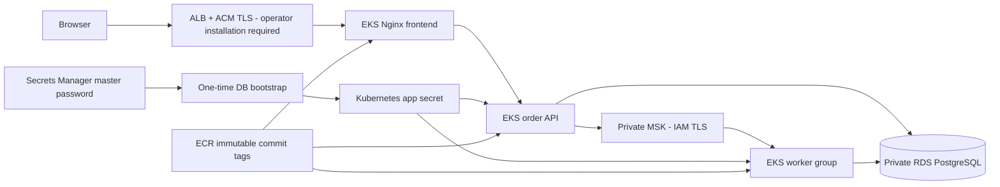

# AWS EKS Deployment Readiness

**Prepared and locally validated; not deployed to AWS in this audit.** No AWS
resources were created, modified, or billed by these steps. Commands below are a
future operator runbook, not evidence that they have been executed.

## Prerequisites and Budget

Use an isolated AWS account, MFA/SSO, a reviewed budget alarm, a chosen region,
and an explicit spending approval. Install Terraform 1.12.2, AWS CLI, Docker
Buildx, kubectl, jq and OpenSSL. Check current regional EKS/Kafka version and
instance availability before provisioning; validation cannot check those remotely.

Planning estimate for this three-node/three-broker sandbox: **roughly $400-$600
per 730-hour month**, before unusual transfer/logging or credits. This is a budget
range, not a quote or a Free Tier promise. For example, the standard-support EKS
control plane alone is about $73/month at $0.10/hour. Node instances, MSK brokers
and storage, RDS, NAT, public IPv4, ALB, logs and data transfer are additional.
The single NAT gateway also charges per processed GB. Review the actual region
in the [AWS calculator](https://calculator.aws/) before any apply.
Sources checked November 5, 2026: [EKS pricing](https://aws.amazon.com/eks/pricing/),
[MSK pricing](https://aws.amazon.com/msk/pricing/),
[NAT billing](https://docs.aws.amazon.com/vpc/latest/userguide/nat-gateway-pricing.html).
No uptime or capacity guarantee follows from this estimate.

## Intended Architecture



`infra/aws` is a wrapper around `deploy/aws`; use **one entry point and one state**.
Do not apply both independently, which could create duplicate chargeable stacks.
The wrapper forwards outputs consumed by `deploy/aws/deploy.sh` using `TF_DIR`.

Implemented Terraform defines a three-AZ VPC, private subnets, one NAT gateway,
EKS managed ARM64 nodes, metrics-server, ECR, private RDS with an AWS-managed master
password, encrypted MSK with IAM authentication, six-partition replicated order/DLT
topics, scoped worker/API IAM roles via IRSA, and EKS control-plane audit logging.

Defaults are a cost-conscious sandbox, not a high-availability production design:
RDS is single-AZ, one NAT is an AZ dependency, node group size is fixed at three,
and `skip_final_snapshot=true` must be changed or an explicit snapshot taken before
destroying data you want to keep. Pod HPA is not cluster/node autoscaling.

## Local Validation Performed

```bash
terraform -chdir=infra/aws fmt -check
terraform -chdir=infra/aws init -backend=false -input=false
terraform -chdir=infra/aws validate
kubectl kustomize deploy/kubernetes/aws
bash -n deploy/aws/deploy.sh
```

Terraform initialization and validation passed without AWS credentials or apply.
This checks syntax/provider schemas, not IAM permissions, resource quotas, a cloud
plan, real add-on compatibility, networking, or an EKS rollout. CI validates both
entry points. Do not commit `.terraform`, state, saved plans or secret tfvars.

## Future Provisioning: Requires Separate Approval

Set an SSO/profile identity, verify the account and region, and choose an IPv4 /32
for your workstation. The EKS API is restricted to `operator_cidrs`.
Use encrypted, access-controlled remote state with locking before shared work.

```bash
# Do not execute until budget and deployment authorization are approved.
aws sts get-caller-identity
terraform -chdir=infra/aws init
terraform -chdir=infra/aws plan \
  -var='aws_account_id=YOUR_12_DIGIT_ACCOUNT' \
  -var='operator_cidrs=["YOUR_PUBLIC_IP/32"]' -out=deployment.tfplan
terraform -chdir=infra/aws apply deployment.tfplan
```

The placeholder account/IP are deliberately not usable values. Review the complete
plan and IAM permissions before apply. Keep the chosen state consistent for destroy.

## Images, Database and Secrets

After a real apply, a clean committed revision can be published/deployed with:

```bash
TF_DIR="$PWD/infra/aws" bash deploy/aws/deploy.sh --deploy
```

The script verifies AWS account identity, publishes ARM64 images under immutable
Git SHA tags, retrieves the RDS root CA, and uses `sslmode=verify-full`. On initial
deployment it uses the Secrets Manager master password only to bootstrap the
`ledgerone_app` role; it then creates a Kubernetes secret for app/JWT credentials.
It preserves those credentials on ordinary releases. This is **not** automatic
Secrets Manager-to-pod rotation. Design and test rotation/External Secrets before
production. Avoid shell tracing when processing secrets.

`deploy/aws/bootstrap-db.yaml` creates the application DB role. Flyway runs V1-V6
at Spring startup. Test backup/restore and existing-data checks before V6 adds its
new uniqueness/check constraints. Never edit an applied migration to force startup.
Store Finnhub only in backend secrets, never in a `VITE_*` variable or source file.

## Application Rollout and Ingress

The AWS Kustomize overlay adds service accounts/IRSA, RDS CA mounts, topology
spreading and disruption budgets. API and worker have CPU HPA and Spring health
probes; scheduler is single-replica. The frontend proxies same-origin `/api` traffic.

Public ingress is **not automatically provisioned by this repository**.
`deploy/kubernetes/aws/ingress.example.yaml` is an opt-in ALB/ACM example excluded
from the default overlay. Before exposing the app, an operator must:

1. Install AWS Load Balancer Controller with its own scoped IAM role/IRSA.
2. Issue and validate an ACM certificate for an owned domain in the selected region.
3. Replace the example host/certificate ARN; review ALB scheme, security groups and TLS.
4. Apply the reviewed ingress, point DNS to the ALB, and restrict CORS to the HTTPS origin.
5. Review seeded demo/admin accounts and disable default passwords for a non-demo service.

Cloud-dependent controller installation, certificate validation and internet access
remain unverified. Follow the current official
[EKS ALB controller guide](https://docs.aws.amazon.com/eks/latest/userguide/lbc-helm.html).
Do not assume the example alone installs a controller or obtains a certificate.

## Smoke Tests and Monitoring After a Future Deploy

```bash
kubectl -n ledgerone get pods,svc,hpa
kubectl -n ledgerone rollout status deployment/ledgerone-api
kubectl -n ledgerone logs deployment/ledgerone-order-worker --tail=100
# Use the actual HTTPS domain after ingress/TLS setup:
curl --fail https://YOUR_DOMAIN/api/system/status
```

Register a disposable test user, confirm one $100K paper account, place a queued
buy and sell, verify broker receipts, final states, exact cash/share/ledger changes,
duplicate replay, rejection and restart recovery. Never run the loopback-restricted
load harness against a cloud service by removing its safeguards casually.

EKS control-plane logs have seven-day retention. Application log shipping,
dashboards, external availability probes, DLT alarms and lag-based autoscaling are
not installed by the Terraform. Add CloudWatch/Prometheus/appropriate agents and
alerts before any service-level claim. Check RDS CPU/connections and MSK lag/ISR
alongside API latency; a status-200 read alone cannot prove healthy trading.

## Rollback and Cleanup

Use the previous immutable image SHA or `kubectl rollout undo` for a reviewed app
rollback. This does not undo a Flyway migration. Restore a backup into an isolated
DB or deploy a reviewed forward migration when schema recovery is required.

For a disposable sandbox, first export evidence/backups. Remove the ALB ingress
and wait for controller cleanup, remove any external DNS/certificate resources
created manually, and review nonempty ECR repositories. Terraform ECR repositories
are intentionally not force-deleted with images. Then, with the same state:

```bash
# Destructive and billable-resource operations; not executed during this audit.
terraform -chdir=infra/aws plan -destroy
terraform -chdir=infra/aws destroy
```

Verify ALBs, NAT, EIPs, EBS, snapshots, logs, ECR and manually installed components
are cleaned up or intentionally retained. Destroy can leave chargeable resources
when blocked by final snapshots, images or service dependencies. A failed destroy
is not proof that billing stopped.
