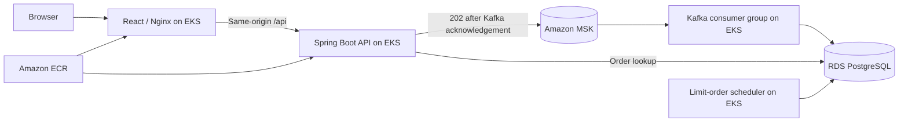

# LedgerOne on AWS

This is a separate, privately accessible sandbox. It does not migrate or modify the
Render/Vercel demo. The repo includes the deployment configuration; an AWS rollout,
cloud benchmark, and availability measurement must still be performed in an authorized account.



## Before Spending

- Estimate EKS, three EC2 nodes, three MSK brokers, RDS, NAT, and storage in the
  [AWS Pricing Calculator](https://calculator.aws/). Review the region and set a budget
  alert. An alert is not a spending cap. Do not run `terraform apply` without approval.
- Use a dedicated sandbox account or role. Install Terraform 1.12+, AWS CLI v2,
  kubectl, Docker with Buildx, jq, curl, and OpenSSL. Sign in locally with an authorized
  profile; do not put AWS keys or app secrets in the repository.
- The operator needs infrastructure permissions, EKS access, ECR push access,
  read access to the RDS-managed master secret, and
  [MSK topic management permissions](https://docs.aws.amazon.com/msk/latest/developerguide/msk-topic-operations-information.html).
  Workloads have separate, narrower [IRSA roles](https://docs.aws.amazon.com/eks/latest/userguide/iam-roles-for-service-accounts.html).

## Review the Infrastructure

```bash
export AWS_PROFILE=YOUR_SANDBOX_PROFILE
aws sts get-caller-identity
terraform -chdir=deploy/aws init
terraform -chdir=deploy/aws validate
terraform -chdir=deploy/aws plan -out=sandbox.tfplan \
  -var 'aws_account_id=YOUR_12_DIGIT_ACCOUNT_ID' \
  -var 'operator_cidrs=["YOUR_PUBLIC_IPV4/32"]'
```

The defaults use `us-east-2` and require three available Availability Zones. Inspect
the plan and regional quotas before a first apply. Keep state and plan files private.
For team use, configure an encrypted, access-controlled remote state backend with locking
before the first apply.

Only after approving the plan and costs:

```bash
terraform -chdir=deploy/aws apply sandbox.tfplan
bash deploy/aws/deploy.sh --deploy
```

The script checks the AWS account against Terraform outputs, uses a temporary
kubeconfig, builds ARM64 images tagged with the Git revision, and waits for each
rollout. It bootstraps a dedicated PostgreSQL login that owns the application schema
objects but is not the RDS master. The bootstrap job and its master credentials are
removed; the application's generated database password and JWT secret are retained
for subsequent releases. Back up those secrets using your approved secret store.
Supply `FINNHUB_API_KEY` to the first deployment via your local environment, or update
the Kubernetes secret through your approved secret manager before restarting the workloads.

The AWS profile uses TLS and hostname verification for RDS, SASL/IAM over TLS for MSK,
and locks the public demo accounts after migrations. Register a new account for the
AWS sandbox. Orders submitted by the AWS frontend go through Kafka and are shown once
the worker has written them to PostgreSQL. The default frontend still uses synchronous
orders unless built with `VITE_QUEUED_ORDERS=true`.

## Verify the Rollout

```bash
aws eks update-kubeconfig --region us-east-2 --name ledgerone-sandbox
kubectl -n ledgerone get pods,svc,hpa
kubectl top nodes
kubectl -n ledgerone port-forward svc/ledgerone-frontend 18080:80
```

Open `http://127.0.0.1:18080`, register, place a small buy, and confirm the order,
holding, and buying power update. With the port-forward running, a second terminal
can run `ORDERS_PER_ACCOUNT=5 node benchmarks/queued-orders.mjs` to verify persisted
fills, replay protection, and buying-power checks on the approved sandbox.

During a separate load test, record the workload, verified fill rate, acknowledgement
latency, consumer lag, DB utilization, replica counts, and errors. The HPA scales API
and worker pods using CPU, not the EC2 node group. That group has a fixed size in this
sandbox. For availability, measure successful user-facing requests over a stated
window with an external monitor. Successful probes, multiple pods, and a short load
test do not establish an uptime percentage. The defaults also use one NAT gateway
and single-AZ RDS; they are not a production HA configuration.

The AWS services are private by design. A public demo requires a separately reviewed
TLS ingress, DNS, CORS configuration, abuse controls, and cost approval.

## Tear Down

Use the same AWS profile and Terraform state. Preserve any data or images you need
first: the sandbox skips a final RDS snapshot, and destroying MSK removes its topics.
The ECR repositories are protected from deletion while nonempty, so remove the
sandbox images explicitly once they are no longer needed. Review
`terraform -chdir=deploy/aws plan -destroy` and destroy only the intended sandbox.
Confirm in AWS that the cluster, brokers, database, NAT, and storage no longer exist.
