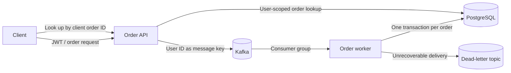

# Distributed Trading Lab

The live LedgerOne demo on Vercel and Render uses the existing synchronous order endpoint.
The Kafka path is opt-in, separate from the live demo, and uses the same trade engine and
PostgreSQL schema. The lab does not claim production throughput, production availability, or
an AWS deployment.

## Order Lifecycle



- `POST /api/orders/queued` takes the same body as `POST /api/orders`. It validates the
  request and account ownership, then returns HTTP 202 only after Kafka acknowledges the
  message. Acknowledged does **not** mean filled or even recorded in PostgreSQL.
- A worker in the configured consumer group rechecks account state and executes the
  existing transactional trade service. Messages use the user ID as the partition key,
  so a user's messages on that topic go to the same partition.
- The worker commits the database transaction before the listener succeeds. A crash
  between the database commit and Kafka offset commit can replay a message. The account
  row lock, duplicate lookup, and unique constraint on `(user_id, client_order_id)` prevent
  a replay from posting another fill. This is at-least-once delivery with an idempotent
  database effect, not an atomic Kafka/PostgreSQL commit.
- A pending limit order does not debit or reserve money or shares. On an eligible price,
  the scheduler reloads the order under the account lock and rechecks cash or shares.
  If the order fills, the cash, holding, order, and ledger changes commit together.
- `GET /api/orders/queued?clientOrderId=YOUR_ID` returns the current persisted order for
  the caller. HTTP 404 means no order row exists for that user and ID. It may still be
  queued, or it may have reached the dead-letter topic without leaving an order row.
  The lab does not have a separate durable failure-status endpoint. Retry an ambiguous
  HTTP 503 with the **same** ID and payload.
- The worker retries transient errors twice and sends unrecoverable records to
  `ledgerone.orders.v1-dlt`. Operators must monitor the dead-letter topic and consumer lag.
  Do not allow untrusted producers to write to the order topic.

## Local Verification

Requires Docker Compose 2.24.4+ and Node.js 20+. Run from the repository root:

```bash
docker compose -p ledgerone-queue -f docker-compose.yml -f docker-compose.queue.yml up -d --build --scale worker=2 backend worker
curl --fail http://127.0.0.1:18080/actuator/health/readiness
node benchmarks/queued-orders.mjs
```

Wait for the readiness endpoint before running the Node script. The queue stack uses seeded
prices instead of live Finnhub requests, six Kafka partitions and one broker, and a separate
PostgreSQL volume. Its HTTP and database ports bind to loopback. The script creates disposable
accounts, submits a bounded concurrent workload, checks filled orders and ledger entries,
replays duplicate IDs, and checks that competing buys cannot both spend the same cash.
It measures **acknowledgements** separately from **verified fills observed in PostgreSQL**.
Polling adds time to the second measurement. This is a local smoke benchmark, not a
sustained capacity test. It rejects non-loopback URLs.
GitHub Actions runs the same checks with a smaller workload against a disposable Compose stack.

One local run on a 2-vCPU, 4-GiB Colima VM used one API replica, two workers, one broker,
PostgreSQL 16, and four accounts submitting 100 orders. It observed 41.3 queue acknowledgements
per second and 14.6 verified fills per second, with 1,055 ms p95 acknowledgement latency.
These describe that run only and are not estimates of production capacity.

```bash
docker compose -p ledgerone-queue -f docker-compose.yml -f docker-compose.queue.yml \
  exec -T db psql -U ledgerone -d ledgerone -f - < benchmarks/index-experiment.sql
```

The index experiment uses 300,000 synthetic rows in a temporary table. It compares the same
portfolio-history read with and without the composite `(portfolio_id, created_at DESC)` key used
in LedgerOne. It reports PostgreSQL's query plan, buffers, and execution time. It does not
measure writes or prove an overall application latency improvement.
In one local run, the read went from a sequential scan (15.120 ms) to an index scan (0.093 ms).
These are single-run query execution times, not API latency or a general database speedup.

## Kubernetes and AWS EKS

The [Kustomize templates](../deploy/kubernetes/) define separate API, worker, and singleton
market-scheduler workloads, startup/readiness/liveness probes, and CPU-based autoscaling for
the API and worker. The worker replica ceiling matches the six partitions in the local lab.
For a real deployment, prefer scaling workers on consumer lag and budget PostgreSQL connections
for the maximum replica count. Readiness checks process readiness and PostgreSQL connectivity,
not whether the broker can accept traffic or whether workers are keeping up.

Before applying to EKS:

1. Provision an authorized EKS cluster and Metrics Server, a private PostgreSQL instance and a
   private Kafka cluster. Configure broker TLS, authentication, ACLs, topic retention, and matching
   partition counts for the order and dead-letter topics. The local broker is not a production setup.
2. Build the backend image for the cluster's architecture, publish it to a registry the cluster
   can pull from, and replace the image in `deploy/kubernetes/kustomization.yaml` with a pinned tag
   or digest. Confirm that `kubectl config current-context` points to the intended cluster.
3. In a dedicated namespace, create `ledgerone-config` with `KAFKA_BOOTSTRAP_SERVERS`,
   `ALLOWED_ORIGINS`, and provider-specific settings. Inject `DATABASE_JDBC_URL`,
   `DATABASE_USERNAME`, `DATABASE_PASSWORD`, `JWT_SECRET`, broker credentials, and any
   `FINNHUB_API_KEY` through `ledgerone-secrets` or a managed secret integration.
   For Kafka settings not directly exposed here, use Spring Boot configuration, for example
   `SPRING_KAFKA_PROPERTIES_SECURITY_PROTOCOL`. Never commit secret values.
4. Run `kubectl -n YOUR_NAMESPACE apply -k deploy/kubernetes` and verify rollouts, the HPA metrics,
   broker reachability, lag, and dead-letter alerts. The manifest creates only a ClusterIP
   service. Keep the deployment private unless public demo credentials seeded by Flyway have
   been disabled or rotated and you have separately configured TLS ingress and access controls.

Health probes and autoscaling configuration do not demonstrate an uptime percentage.
An uptime claim needs an externally measured success rate, measurement period, and workload
definition from a real deployment.

References: [Spring Kafka retries and dead-letter records](https://docs.spring.io/spring-kafka/reference/kafka/annotation-error-handling.html),
[Kubernetes Horizontal Pod Autoscaling](https://kubernetes.io/docs/concepts/workloads/autoscaling/horizontal-pod-autoscale/).
